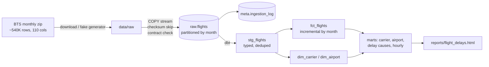

# Airline Performance Pipeline

An end-to-end data pipeline for U.S. flight on-time data from the Bureau of Transportation Statistics (BTS):
incremental, idempotent bulk loads into partitioned PostgreSQL, dbt models with 31 data-quality checks,
CI that proves re-runs are safe, and a one-page report.

> Built because of what I saw at Maersk: slow connections and long-running jobs on carrier data.
> This project is about the pipeline side: loading fast, reloading safely, and knowing the data is right.



## What makes it data engineering, not just analysis

| | How | Where |
|---|---|---|
| **Fast loads** | Postgres `COPY` streamed straight from the zip, constant memory (~160K rows/s locally) | `pipeline/ingest.py` |
| **Idempotent** | Files fingerprinted with SHA-256; already-loaded files are skipped. CI runs everything twice and fails if anything changes | `ingest.py`, `.github/workflows/ci.yml` |
| **Atomic** | A month is replaced in one transaction (truncate partition + insert). A crash never leaves half a month | `ingest.py` |
| **Partitioned** | `raw.flights` has one partition per month, so a reload touches one month only | `sql/bootstrap.sql` |
| **Incremental** | `fct_flights` rebuilds only the months loaded since its last run (delete+insert on month) | `transform/models/marts/fct_flights.sql` |
| **Data contract** | Required columns are checked before loading. A renamed source column fails loudly instead of loading NULLs | `pipeline/bts_schema.py` |
| **Tested** | 31 checks: keys, relationships, accepted values, staging↔fact reconciliation, "delay causes sum to ArrDelay", freshness | `transform/tests`, `_marts.yml` |
| **Observable** | Every load attempt (success or failure) logged with rows and duration; `python -m pipeline status` | `meta.ingestion_log` |
| **Reproducible** | One env config for laptop / Docker / CI; fake data generator for offline runs | `pipeline/config.py`, `docker-compose.yml` |

## Quickstart (fake data, ~1 minute)

You need Postgres running (Postgres.app is fine) with a database called `flights`.

```bash
# dbt doesn't support Python 3.14 yet -> use 3.12 for this venv
brew install python@3.12            # if you don't have it
python3.12 -m venv .venv && source .venv/bin/activate
pip install -r requirements.txt

cp .env.example .env                # set PGUSER to your Mac username
python -m pipeline run --source fake --months 2025-01:2025-03
open reports/flight_delays.html
```

Try the data engineering parts yourself:

```bash
python -m pipeline run --months 2025-01:2025-03   # second run: every file "skip", dbt rebuilds nothing new
python -m pipeline status                         # what's loaded, row counts, load times
make docs                                         # dbt lineage graph in the browser
```

## Switching to real BTS data

The fake generator writes files with **the exact names, headers and quirks of the real BTS downloads**,
so nothing in the code changes. Only where the files come from changes.

**Option A: let the pipeline download them**
```bash
make clean                                        # removes fake files + report (keeps your database)
python -m pipeline run --source real --months 2025-01:2025-03
```
Downloads from `https://transtats.bts.gov/PREZIP/On_Time_Reporting_Carrier_On_Time_Performance_1987_present_{YYYY}_{M}.zip`.

**Option B: you already have the files** (like your Jan 2025 download)
1. Put the `.zip` or `.csv` in `data/raw/`. Any name works; the month is read from `FlightDate`.
2. `python -m pipeline ingest && python -m pipeline transform && python -m pipeline report`

**Start the database clean** so fake rows don't mix with real ones:
```bash
dropdb flights && createdb flights
```

Things to expect with real data:
- ~540K rows/month instead of 60K. Still seconds per month with COPY.
- New carriers not in `transform/seeds/carriers.csv` show up as "Unknown (XX)" and a **warning** test tells you to add them.
- Real data has a few extreme delays (20+ hours). The range test is a warning, not an error, for that reason.
- **Re-check the key findings** in the report before quoting them; the fake data was designed to look realistic, not to match real numbers.

## Project layout

```
pipeline/                 Python: CLI, download, fake generator, ingestion, report
  __main__.py             python -m pipeline {run,get,ingest,transform,report,status}
  bts_schema.py           the data contract (required BTS columns)
  ingest.py               COPY loader: checksum, contract, atomic partition swap, logging
sql/bootstrap.sql         raw + meta schemas, partitioned landing table, ingestion log
transform/                dbt project
  models/staging/         stg_flights: types, HHMM -> minutes, dedup, surrogate key
  models/marts/           fct_flights (incremental), dim_carrier, dim_airport, 4 marts
  tests/                  reconciliation + business-rule tests
  seeds/carriers.csv      carrier names
docs/                     interview notes (concepts + practice questions)
.github/workflows/ci.yml  full pipeline + idempotency check on every push
```

## Data model

`fct_flights`: one row per scheduled flight (grain). Key columns: `flight_id` (md5 surrogate), `data_month`,
`carrier_code`, `origin_airport`, `dest_airport`, `crs_dep_hour`, `dep_delay_min`, `arr_delay_min`,
`is_cancelled`, `is_diverted`, `is_on_time` (DOT definition: arrived < 15 min late), five delay-cause columns.

| Mart | Question it answers |
|---|---|
| `mart_carrier_monthly` | Which airlines are on time, cancel least, have the worst tail delays (p90)? |
| `mart_airport_monthly` | Which airports depart late, and is ground congestion (taxi-out) why? |
| `mart_delay_causes` | Are delays the airline's fault, weather, air traffic, or knock-on from late aircraft? |
| `mart_hourly_delay` | How does performance decay through the day? |

## Design decisions

- **Raw as text.** A weird value never breaks a load halfway; typing happens in tested dbt SQL, and raw can always be replayed.
- **Month as the unit of work.** BTS publishes and corrects data by month, so partitions, idempotency and incremental rebuilds all use the month.
- **delete+insert instead of merge.** If a corrected file *removes* flights, a merge on `flight_id` would leave them behind; swapping the whole month can't.
- **No pandas in the load path.** pandas loads the whole file into memory and `to_sql` inserts in batches; COPY streams.

## Roadmap

- Schedule with Airflow or Dagster (monthly, with retries + Slack alert). Idempotency already makes retries safe.
- Backfill 2019–2025 and compare pre/post-COVID performance.
- Convert local times to UTC using airport timezones for true duration math.
- Land raw files as Parquet in object storage (S3/GCS) and point dbt at a warehouse (BigQuery/Snowflake).
