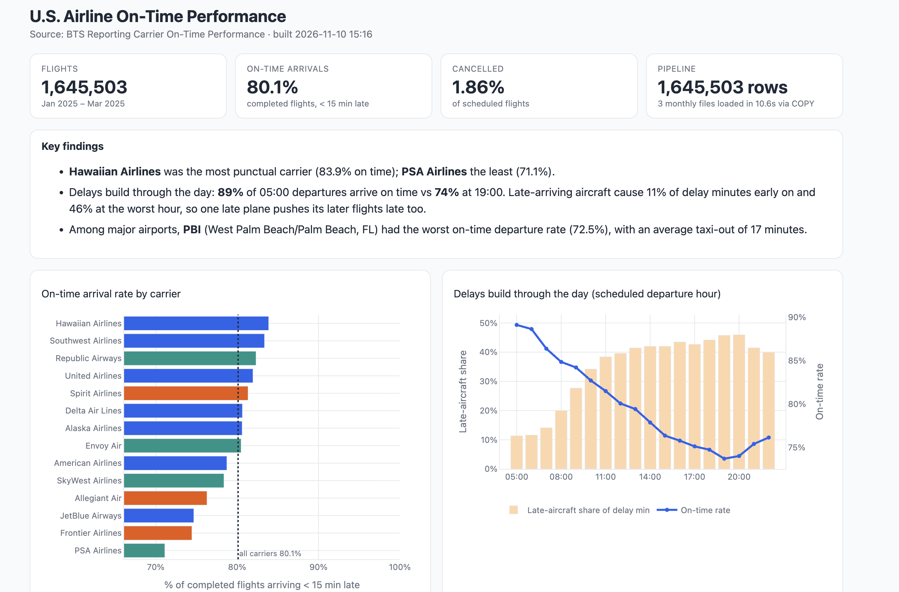
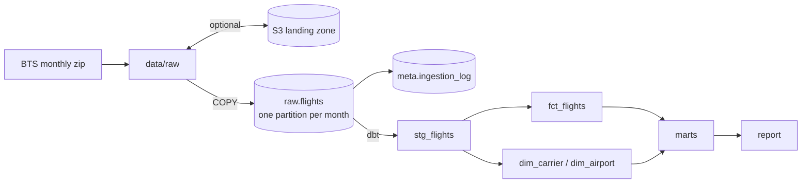

# Airline Performance Pipeline

I got interested in the pipeline side of data during my data internship at Maersk, where a lot of time went into waiting on slow connections and long-running jobs. This project is my attempt at building one properly.

It loads monthly flight data from the Bureau of Transportation Statistics into Postgres, cleans and models it with dbt, and builds a short report on which airlines, airports and times of day have the most delays. A few things I focused on:

- Loading uses Postgres `COPY` instead of row-by-row inserts, so a full month (~540K rows) loads in seconds.
- Every file is checksummed and logged, so running the pipeline twice doesn't load anything twice.
- Each month lives in its own partition and gets replaced in a single transaction, so a corrected file from BTS just swaps that month out.
- The dbt fact table is incremental and only rebuilds months that changed.
- There are 22 dbt data tests, and GitHub Actions runs the whole thing on every push (twice, to check that re-runs don't change anything).
- Raw files can land in an S3 bucket first, so the database can be rebuilt from S3 on any machine. The database itself can be Amazon RDS.





## Running it

I run Postgres through Postgres.app. Make an empty database first:

```bash
createdb airline
```

Then set up Python. dbt doesn't support Python 3.14 yet, so the environment uses 3.12 (I used [uv](https://github.com/astral-sh/uv) because pip was giving me trouble on macOS):

```bash
uv venv --python 3.12 .venv
source .venv/bin/activate
uv pip install -r requirements.txt
```

Copy `.env.example` to `.env` and put in your Postgres username and the database name. Then:

```bash
python -m pipeline run --source fake
open reports/flight_delays.html
```

`--source fake` generates three months of made-up data in the same format as the real BTS files, which is handy for testing without downloading anything. If you run the same command again, every file should show `skip`. `python -m pipeline status` shows what's loaded.

## Using the real data

```bash
python -m pipeline run --source real --months 2025-01:2025-03
```

This downloads the monthly zips from [BTS](https://www.transtats.bts.gov/) into `data/raw/`. If you already have a file downloaded, you can drop it in that folder and run `python -m pipeline ingest` instead. The pipeline reads the month from the data itself, so the file name doesn't matter.

If you tried the fake data first, start with a fresh database so the two don't mix (`dropdb airline && createdb airline`).

## Running it on AWS (optional)

Everything above works without AWS. To use it, set a couple of extra values in `.env` (see `.env.example`):

- **S3:** set `S3_BUCKET`. Every file the pipeline downloads or generates is uploaded to `s3://<bucket>/raw/bts/`, and `python -m pipeline ingest` pulls down anything in the bucket that isn't on the machine yet. So a brand-new machine can rebuild the whole database with just `python -m pipeline ingest`.
- **RDS:** point `PGHOST`, `PGUSER` and `PGPASSWORD` at an Amazon RDS for PostgreSQL instance and set `PGSSLMODE=require`. Nothing else changes, since the Python side and dbt read the same variables.

AWS credentials come from `aws configure`, never from the repo. CI tests the S3 path against a mocked S3 ([moto](https://github.com/getmoto/moto)), so it runs without an AWS account.

## Next steps

- Schedule it with Airflow so new months load automatically.
- Backfill more years to compare performance over time.
